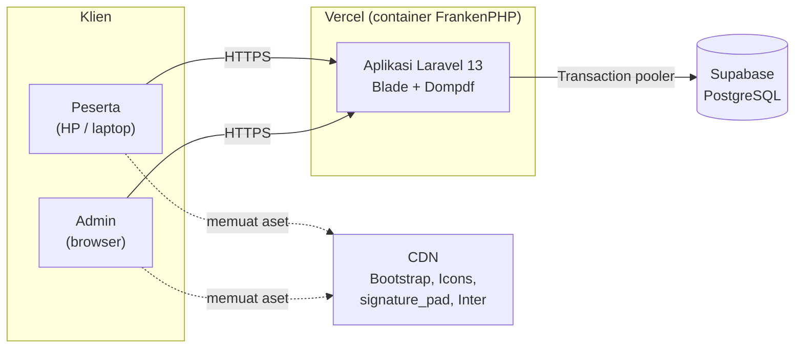
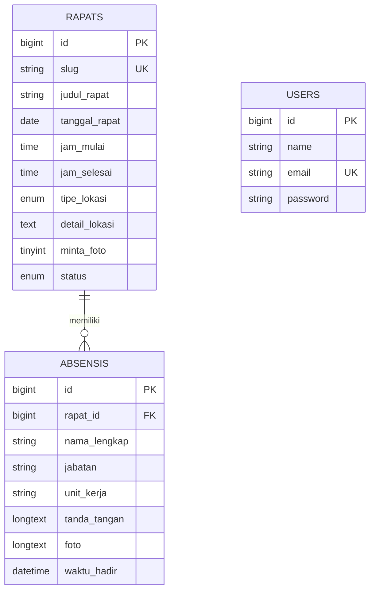
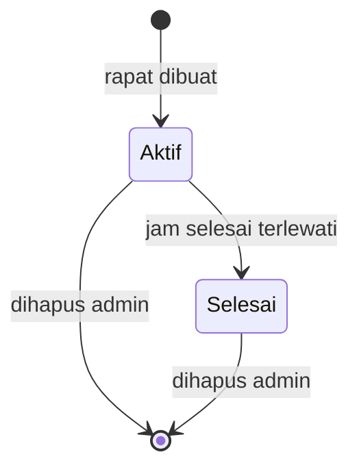
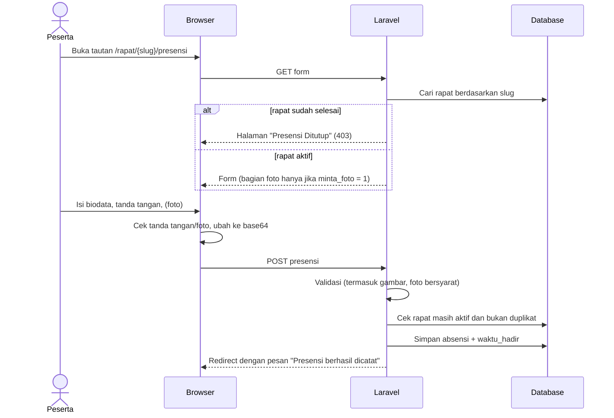
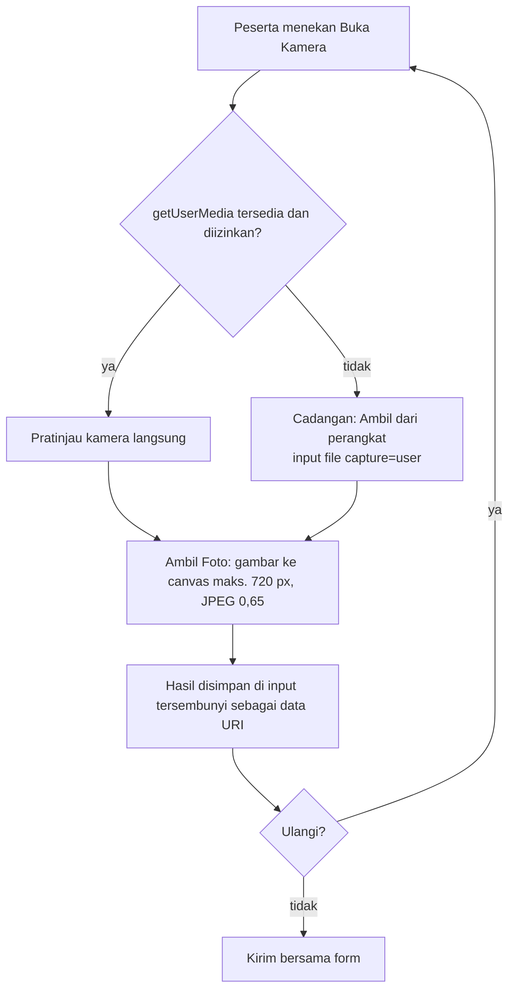
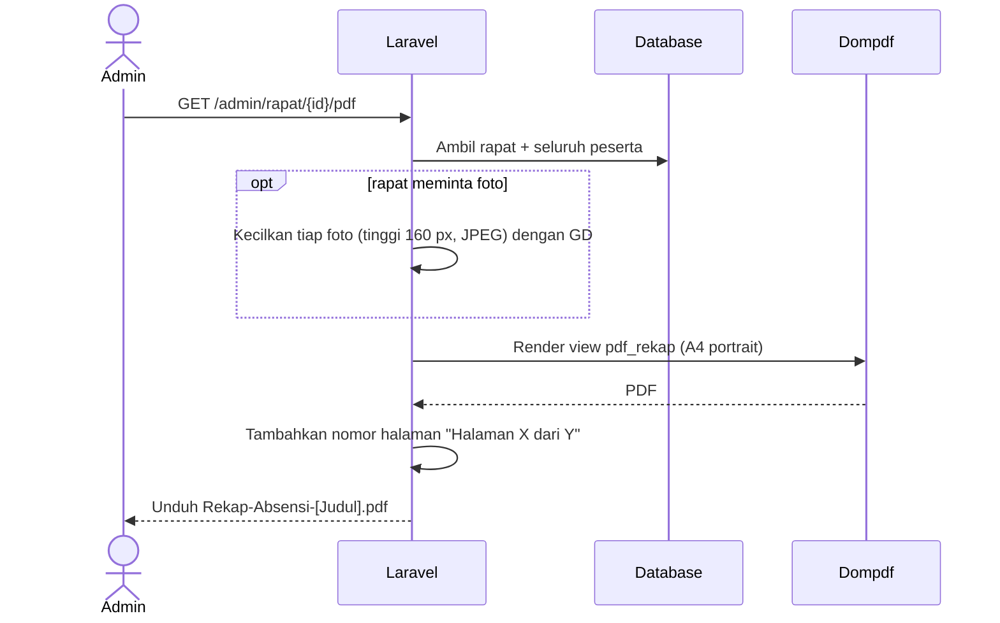
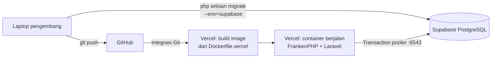

# Design — Sistem Presensi Rapat Digital

Dokumen ini menjelaskan **rancangan teknis dan antarmuka** aplikasi: arsitektur, alur proses, desain data, keamanan, sistem desain visual, dan alasan di balik keputusan penting. Untuk panduan instalasi dan penggunaan, lihat [`README.md`](README.md).

> Terakhir diperbarui: 23 November 2026.

## Daftar Isi

1. [Tujuan dan Ruang Lingkup](#tujuan-dan-ruang-lingkup)
2. [Prinsip Desain](#prinsip-desain)
3. [Arsitektur](#arsitektur)
4. [Desain Data](#desain-data)
5. [Alur Proses](#alur-proses)
6. [Desain Keamanan](#desain-keamanan)
7. [Desain Antarmuka](#desain-antarmuka)
8. [Desain Dokumen PDF](#desain-dokumen-pdf)
9. [Desain Deployment](#desain-deployment)
10. [Keputusan Desain](#keputusan-desain)
11. [Keterbatasan dan Arah Pengembangan](#keterbatasan-dan-arah-pengembangan)

---

## Tujuan dan Ruang Lingkup

**Masalah.** Daftar hadir rapat berbasis kertas sulit direkap, mudah hilang, dan tidak memberi bukti kehadiran yang kuat.

**Tujuan.**

- Peserta dapat mengisi presensi dari perangkat masing-masing hanya dengan membuka tautan, tanpa membuat akun.
- Kehadiran dibuktikan dengan tanda tangan digital, dan dengan foto bila rapat memintanya.
- Admin dapat membuat rapat, memantau kehadiran, dan menghasilkan daftar hadir resmi dalam format PDF.

**Di luar lingkup (saat ini).** Pengelolaan akun dan peran admin, edit rapat, notifikasi (email/WhatsApp), ekspor Excel, dan integrasi dengan sistem kepegawaian.

**Pengguna.**

| Peran | Akses | Kebutuhan utama |
|---|---|---|
| Peserta | Publik, tanpa login | Mengisi presensi secepat mungkin, terutama dari HP |
| Admin | Login | Membuat rapat, memantau kehadiran, mencetak rekap |

---

## Prinsip Desain

1. **Mobile-first.** Peserta umumnya mengisi dari HP di ruang rapat. Target sentuh minimal 44 px, satu kolom, dan tanda tangan serta kamera langsung di halaman.
2. **Tanpa hambatan bagi peserta.** Tidak ada akun, tidak ada instalasi. Satu tautan, satu form.
3. **Sederhana dan bisa dirawat.** Laravel monolit dengan Blade, tanpa framework JavaScript dan tanpa proses build aset. Pustaka UI dimuat dari CDN.
4. **Server sebagai sumber kebenaran.** Setiap aturan penting (rapat aktif, foto wajib, validasi gambar) dicek ulang di server, bukan hanya di browser.
5. **Cocok untuk hosting serverless.** Tidak bergantung pada disk lokal yang permanen. Data gambar disimpan di database.
6. **Privasi secara bawaan.** Tanda tangan dan foto hanya dapat dilihat admin yang login.

---

## Arsitektur

### Gambaran umum



Pengembangan lokal memakai pola yang sama dengan MySQL dan `php artisan serve`.

### Lapisan aplikasi

```
Rute (routes/web.php)
   │   middleware: auth, guest, throttle
   ▼
Controller ───── Form Request (validasi)
   │                │
   ▼                ▼
Model (Eloquent) ── Database
   │
   ▼
View (Blade) ── CSS/JS kustom + pustaka CDN
```

| Lapisan | Tanggung jawab | Berkas |
|---|---|---|
| Rute | Pemetaan URL, penjaga akses, pembatasan laju | `routes/web.php` |
| Controller | Alur permintaan dan respons | `RapatController`, `AdminController`, `AuthController` |
| Form Request | Validasi dan otorisasi input | `StorePresensiRequest`, `StoreRapatRequest` |
| Model | Relasi, status otomatis, scope kueri | `Rapat`, `Absensi`, `User` |
| View | Tampilan dan interaksi sisi klien | `resources/views/**` |
| PDF | Penyusunan dokumen cetak | `admin/pdf_rekap.blade.php` + Dompdf |

### Pembagian tanggung jawab

| Controller | Domain |
|---|---|
| `RapatController` | Sisi publik: katalog, form presensi, simpan presensi, jumlah hadir |
| `AdminController` | Sisi admin: dashboard, tambah/hapus rapat, detail, PDF, penyajian gambar |
| `AuthController` | Login dan logout |

---

## Desain Data

### Model relasi



`users` berdiri sendiri. Tabel itu hanya dipakai untuk login admin dan tidak terhubung ke data rapat.

### Keputusan data

| Topik | Keputusan | Alasan |
|---|---|---|
| Identitas rapat di URL publik | `slug` (judul + 6 karakter acak), bukan `id` | Tautan tidak dapat ditebak urut, dan mudah dibaca. Admin memakai `id` karena sudah dilindungi login. |
| Tanda tangan dan foto | Disimpan sebagai base64 (`longtext`) di tabel `absensis` | Disk Vercel tidak permanen. Tidak perlu layanan penyimpanan tambahan. Konsekuensinya database membesar. |
| Ukuran gambar | Foto dikecilkan di browser (maksimal 720 px, JPEG kualitas 0,65). Tanda tangan memakai PNG berlatar putih. | Menekan ukuran data dan waktu unggah di jaringan seluler. |
| Penanda foto per rapat | Kolom `minta_foto` bertipe `tinyint` (0/1), bukan boolean | PostgreSQL boolean dapat bermasalah dengan pengaturan emulate prepares yang diperlukan Transaction pooler Supabase. Kolom angka aman di MySQL dan PostgreSQL. |
| Status rapat | Kolom `status` hanya bernilai awal `aktif`. Status sebenarnya **dihitung** dari waktu. | Tidak perlu tugas terjadwal untuk menutup rapat. Status selalu akurat. |
| Hapus rapat | Data peserta dihapus eksplisit dalam transaksi, selain `ON DELETE CASCADE` | Tidak ada data peserta yatim, dan penghapusan bersifat atomik. |
| Daftar peserta di admin | Kueri tidak memuat kolom gambar | Halaman tetap ringan. Gambar diambil per baris lewat rute khusus dan dimuat malas (`loading="lazy"`). |

### Kompatibilitas MySQL dan PostgreSQL

Aplikasi berjalan di MySQL (lokal) dan PostgreSQL (produksi). Dua perbedaan ditangani di `Rapat.php`:

- **Gabungan tanggal dan jam.** MySQL memakai `TIMESTAMP(tanggal_rapat, jam_selesai)`, PostgreSQL memakai `(tanggal_rapat + jam_selesai)`. Dipilih otomatis berdasarkan driver koneksi.
- **Pencarian.** `LIKE` di PostgreSQL membedakan huruf besar-kecil, sehingga dipakai `ILIKE`.

---

## Alur Proses

### Status rapat



Status "Selesai" tidak disimpan, tetapi dihitung setiap kali dibutuhkan. Presensi diterima hanya selama status **Aktif**, yaitu dari rapat dibuat sampai jam selesai (peserta bisa mengisi sebelum jam mulai).

### Pengisian presensi



Pengecekan "rapat masih aktif" dilakukan **dua kali** (saat form dibuka dan saat data dikirim), karena rapat bisa berakhir selagi form terbuka.

### Pengambilan foto di browser



### Unduh PDF



Foto dikecilkan sebelum masuk PDF agar ukuran file dan pemakaian memori tetap wajar pada fungsi serverless.

### Hapus rapat (satu atau massal)

1. Admin menekan tombol hapus atau memilih beberapa rapat dengan kotak centang.
2. Jendela konfirmasi menampilkan judul, jumlah peserta (pada hapus tunggal) atau daftar judul (pada hapus massal), serta peringatan bahwa data ikut terhapus permanen.
3. Setelah konfirmasi, data peserta dan rapat dihapus dalam satu transaksi, lalu admin kembali ke dashboard dengan pencarian dan filter yang sedang aktif.

---

## Desain Keamanan

| Ancaman | Mitigasi |
|---|---|
| Akses admin tanpa login | Middleware `auth` pada seluruh `/admin/*`. Pengguna yang belum login diarahkan ke `/login`. |
| Tebak kata sandi | Pembatasan 5 percobaan login per menit. Session diregenerasi setelah login. |
| Spam presensi | Pembatasan 10 pengiriman per menit per IP, pencegahan nama dan unit kerja ganda, dan tombol kirim yang menonaktifkan diri. |
| Data gambar berbahaya | Validasi server: hanya data URI PNG/JPEG yang terbaca sebagai gambar, dengan batas panjang. Gambar disajikan dengan `Content-Type` dari hasil validasi dan `nosniff`. |
| Kebocoran tanda tangan dan foto | Hanya tersedia lewat rute admin, header `private`, tidak ikut dimuat di halaman daftar. |
| XSS | Blade meng-escape keluaran. Teks dinamis pada JavaScript dimasukkan dengan `textContent`. |
| CSRF | Token CSRF pada semua formulir. Penghapusan memakai `DELETE` lewat form, bukan tautan. |
| Menumpuk data di session | Gambar base64 dikecualikan dari data yang di-flash saat validasi gagal. |
| Akses langsung ke database | RLS diaktifkan pada tabel Supabase tanpa policy, sehingga Data API tidak dapat membaca tabel. Laravel memakai role yang tidak terkena RLS. |
| Kredensial bocor | Kredensial hanya lewat environment variables. `.env*` dikecualikan dari image dan tidak boleh di-commit. |

**Batas yang disadari.** Presensi dari tautan publik tidak memverifikasi identitas peserta. Siapa pun yang memegang tautan dapat mengisi dengan nama apa pun. Tanda tangan dan foto menjadi bukti pendukung, bukan otentikasi. Semua akun pada tabel `users` memiliki hak admin yang sama.

---

## Desain Antarmuka

### Landasan

- **Bootstrap 5.3.3** sebagai kerangka (grid, form, tombol, kartu, modal, toast, pagination) dan **Bootstrap Icons 1.11.3** untuk ikon.
- **`public/css/app.css`** menimpa tampilan Bootstrap lewat satu blok *design tokens*, sehingga tema diubah dari satu tempat tanpa mengedit view.
- Tata letak berpusat pada satu layout (`layouts/app.blade.php`) berisi header, area konten `container`, footer, dan wadah notifikasi toast.

### Design tokens

Nilai di bawah adalah isi `:root` pada `public/css/app.css`.

**Warna**

| Token | Nilai | Dipakai untuk |
|---|---|---|
| `--color-primary` | `#0f766e` | Tombol utama, tautan, tab filter aktif, ikon informasi, aksen |
| `--color-primary-dark` | `#0d625b` | Keadaan hover dan aktif pada tombol utama |
| `--color-primary-soft` | `#ccfbf1` | Latar lembut berwarna utama (`bg-primary-subtle`) |
| `--color-primary-rgb` | `15, 118, 110` | Harus sama dengan warna utama (dipakai utilitas Bootstrap seperti `text-primary`) |
| `--color-bg` | `#f4f6fb` | Latar halaman |

**Warna semantik** (dari Bootstrap)

| Makna | Kelas | Contoh pemakaian |
|---|---|---|
| Sukses / aktif | `text-bg-success`, `alert-success` | Badge "Aktif", pesan berhasil |
| Netral / selesai | `text-bg-secondary` | Badge "Rapat Selesai" |
| Informasi | `text-bg-info` | Badge "Foto bukti diminta" |
| Bahaya | `btn-danger`, `alert-danger`, `text-danger` | Tombol hapus, pesan error, tanda wajib `*` |

**Tipografi**

| Token | Nilai |
|---|---|
| `--font-family` | `Inter`, lalu `system-ui`, `-apple-system`, `Segoe UI`, `sans-serif` |
| `--font-size-base` | `15px` (ukuran `rem` dasar; seluruh skala mengikuti) |
| Bobot | 400 (teks), 600 dan 700 (judul dan label penting) |
| Judul halaman | `h4`/`h5` tebal. Judul kartu `h6`. Teks sekunder `small` berwarna `text-secondary`. |

**Bentuk dan ukuran**

| Token | Nilai | Dipakai untuk |
|---|---|---|
| `--radius-card` | `1rem` | Sudut kartu |
| `--btn-min-height` | `44px` | Tinggi minimum tombol (target sentuh) |
| `--icon-size` | `1.05em` | Ukuran ikon relatif terhadap teks |
| `--icon-size-btn` | `1.15rem` | Ikon di dalam tombol |
| `--icon-color-info` | warna utama | Ikon pada daftar informasi rapat |

### Komponen

| Komponen | Spesifikasi |
|---|---|
| **Tombol utama** | `btn-primary` berwarna utama. Hover memakai warna gelap. Tinggi minimum 44 px, ikon dan teks diberi jarak. |
| **Tombol sekunder** | `btn-outline-primary` dan `btn-outline-secondary`. |
| **Tombol hapus** | `btn-danger` (merah solid) agar berbeda dari tombol PDF (`btn-outline-danger`). |
| **Kartu rapat** | Kartu putih tanpa garis tepi dengan bayangan lembut, sudut 1 rem. Pada perangkat dengan hover, kartu naik 3 px saat disorot. |
| **Badge status** | Kapsul (`rounded-pill`): hijau untuk Aktif, abu-abu untuk Rapat Selesai. |
| **Tab filter** | Kapsul putih berbingkai. Tab aktif berlatar warna utama. Dapat digeser horizontal di layar sempit tanpa scrollbar. |
| **Kolom pencarian** | Input besar dengan ikon kaca pembesar di dalam grup input. |
| **Kanvas tanda tangan** | Kotak bergaris putus-putus, latar putih, tinggi 220 px, pena biru tua (`rgb(20,20,60)`), tebal garis 0,8 sampai 2,4. Teks petunjuk hilang saat mulai menulis. |
| **Kotak foto** | Rasio 4:3, bingkai putus-putus. Tiga keadaan: awal (petunjuk), kamera menyala (video langsung), dan hasil (pratinjau). |
| **Notifikasi (toast)** | Muncul di bawah tengah layar selama 2,5 detik. Fungsi global `showToast(pesan, jenis)`. |
| **Modal** | Pratinjau tanda tangan/foto, dan konfirmasi hapus (menampilkan peringatan dan jumlah). |
| **Tabel admin** | `table-responsive` dengan baris yang menyala saat disorot. Kolom aksi rata kanan. |
| **Bar aksi massal** | Kotak merah muda di atas tabel, muncul hanya saat ada rapat yang dipilih, berisi jumlah dan tombol "Hapus terpilih". |

### Inventaris halaman

| Halaman | Rute | Isi utama |
|---|---|---|
| Katalog | `/` | Judul, kolom pencarian, tab filter, grid kartu rapat (1 kolom di HP, 2 di tablet, 3 di desktop), pagination |
| Form presensi | `/rapat/{slug}/presensi` | Ringkasan rapat, form biodata, kanvas tanda tangan, kotak foto (bersyarat), tombol kirim. Setelah sukses diganti kartu "Presensi Berhasil". |
| Presensi ditutup | (respons 403) | Ikon gembok, pesan, tombol kembali ke katalog |
| Login admin | `/login` | Kartu login di tengah |
| Dashboard | `/admin` | Empat kartu statistik, pencarian dan filter, bar aksi massal, tabel rapat, pagination |
| Tambah rapat | `/admin/rapat/create` | Form dengan pilihan tipe lokasi bergaya tombol, bantuan lokasi dinamis, saklar foto |
| Detail rapat | `/admin/rapat/{id}` | Info rapat, tombol salin tautan dan PDF, tabel peserta, pratinjau modal |

### Susunan halaman dan responsivitas

```
┌───────────────────────────────────────────────┐
│ Header (menempel di atas)                     │
│ [Logo]  Sistem Presensi Rapat Digital  [Admin]│
├───────────────────────────────────────────────┤
│ Konten (.container, padding vertikal 1,5 rem) │
│                                               │
│  Katalog:  [ Cari...                       ]  │
│            (Semua)(Aktif)(Selesai)            │
│            ┌────┐ ┌────┐ ┌────┐               │
│            │Kartu│ │Kartu│ │Kartu│  3 kolom   │
│            └────┘ └────┘ └────┘  (desktop)    │
│                                               │
├───────────────────────────────────────────────┤
│ Footer: © tahun Stasiun PSDKP Cilacap         │
└───────────────────────────────────────────────┘
         Toast tampil di bawah tengah layar
```

- **Mobile-first.** Form presensi memakai satu kolom dengan lebar maksimum 620 px, input berukuran besar, dan tombol kirim selebar penuh.
- **Tab filter** dapat digeser horizontal. Tabel admin dapat digeser horizontal pada layar sempit.
- **Header.** Pada layar sangat sempit, teks tombol login admin menyusut menjadi "Admin".

### Interaksi

| Interaksi | Perilaku |
|---|---|
| Pencarian katalog | Menyaring kartu di sisi klien saat mengetik (tidak peka huruf besar-kecil dan aksen), dengan pesan "Tidak ada rapat yang cocok" bila kosong. |
| Jumlah hadir | Diperbarui setiap 15 detik lewat `/rapat-counts`. Berhenti saat tab tidak terlihat. |
| Bagikan tautan | Salin ke clipboard. Jika tidak tersedia (bukan HTTPS), dipakai cara cadangan, dan di halaman admin dengan kotak dialog salin manual. |
| Tanda tangan | Kanvas menyesuaikan resolusi layar (maksimal 2×). Coretan tidak hilang saat address bar HP bergeser. Tombol "Hapus TTD" mengosongkan kanvas. |
| Kirim presensi | Memeriksa tanda tangan dan foto lebih dulu, menampilkan pesan error dan menggulir ke bagian yang salah. Setelah valid, tombol menampilkan spinner dan nonaktif untuk mencegah klik ganda. |
| Pilih massal | Kotak centang header memilih semua rapat di halaman. Statusnya setengah terisi jika sebagian terpilih. |

### Aksesibilitas

- Setiap input memiliki `label`. Tanda wajib memakai `*` berwarna merah.
- Kotak centang pada tabel dan tombol ikon memiliki `aria-label` atau `title`.
- Gambar pratinjau memiliki teks alternatif yang memuat nama peserta.
- Notifikasi memakai `role="status"`.
- Warna tidak menjadi satu-satunya penanda: status selalu disertai teks ("Aktif", "Rapat Selesai"), dan error disertai pesan tertulis.

---

## Desain Dokumen PDF

Dokumen daftar hadir dibuat dengan Dompdf dari view `admin/pdf_rekap.blade.php`.

| Aspek | Spesifikasi |
|---|---|
| Kertas | A4 portrait. Margin 25 px atas, 40 px kiri-kanan, 56 px bawah. |
| Font | Helvetica 10 px (font bawaan PDF, tidak perlu di-embed). |
| Kop | Logo di kiri. Teks tengah terdiri dari enam baris: nama kementerian, nama direktorat jenderal, nama unit, alamat, dan dua baris kontak. Tiga baris pertama berwarna biru dan huruf kapital. Garis ganda di bawah kop. Isi dari `config/instansi.php`, tanda `\|` memisahkan baris. |
| Judul | "DAFTAR HADIR RAPAT", huruf kapital, rata tengah, bergaris bawah. |
| Informasi rapat | Judul rapat, hari dan tanggal, waktu, jumlah hadir. |
| Tabel | Header berlatar abu-abu muda dan diulang di setiap halaman. Baris tidak terpotong antar halaman. |
| Kolom tanpa foto | No (6%), Nama Lengkap (28%), Jabatan (20%), Unit Kerja (20%), Waktu Hadir (10%), Tanda Tangan (16%). |
| Kolom dengan foto | No (5%), Nama (22%), Jabatan (16%), Unit Kerja (16%), Waktu Hadir (9%), Tanda Tangan (16%), Foto (16%). |
| Gambar | Tanda tangan selebar 80 px. Foto setinggi 55 px (diambil dari miniatur 160 px). |
| Bila kosong | Satu baris "Belum ada peserta yang hadir." selebar tabel. |
| Kaki | "Dicetak oleh [nama admin] pada [tanggal, jam] WIB" dan nomor halaman "Halaman X dari Y" di kanan bawah. |
| Nama file | `Rekap-Absensi-[Judul-Rapat].pdf` (judul diubah menjadi huruf dan angka dipisah tanda hubung, maksimal 80 karakter). |

Lebar kolom total selalu 100%, dan `colspan` baris kosong mengikuti jumlah kolom (6 atau 7). Dompdf hanya mendukung CSS 2.1, sehingga tata letak memakai tabel dan warna ditulis langsung (tanpa variabel CSS).

---

## Desain Deployment



| Keputusan | Alasan |
|---|---|
| Runtime container (FrankenPHP) | Laravel tidak memiliki preset bawaan di Vercel. Container memberi kontrol atas versi PHP dan ekstensi (`gd`, `pdo_pgsql`). |
| Nama `Dockerfile.vercel` | Membuat Vercel memilih container alih-alih mendeteksi Vite dari `package.json`. |
| Session dan cache di database | Container tidak memiliki disk permanen dan dapat berjalan sebagai beberapa instance. |
| Log ke `stderr` | Terbaca di Runtime Logs Vercel. |
| Migrasi dari laptop, bukan saat container menyala | Beberapa instance dapat menyala bersamaan. Migrasi diperlakukan sebagai langkah rilis terpisah. |
| Pooler Supabase | Direct connection pada plan gratis hanya lewat IPv6. Transaction pooler cocok untuk koneksi singkat dan banyak. |
| `ATTR_EMULATE_PREPARES` aktif | Transaction pooler tidak mendukung prepared statements. |
| `trustProxies` | Agar URL dan deteksi HTTPS benar di belakang proxy Vercel. |

---

## Keputusan Desain

Ringkasan keputusan penting beserta pertimbangannya.

| # | Keputusan | Alternatif yang dipertimbangkan | Alasan memilih |
|---|---|---|---|
| 1 | Blade + Bootstrap dari CDN, tanpa build | SPA React atau pipeline Vite | Aplikasi sederhana, tim kecil, tidak perlu Node.js. Lebih mudah dirawat. |
| 2 | Status rapat dihitung dari waktu | Kolom status diperbarui oleh tugas terjadwal | Tidak ada komponen tambahan dan tidak ada status basi. |
| 3 | Gambar base64 di database | Object storage (misalnya Supabase Storage) | Tanpa layanan tambahan dan kunci API tambahan. Cocok untuk skala kecil. |
| 4 | Foto bersifat opsional per rapat dan ditentukan saat pembuatan | Foto selalu wajib, atau dapat diubah setelah rapat dibuat | Sesuai kebutuhan: ada rapat yang hanya meminta tanda tangan. Edit rapat belum tersedia. |
| 5 | Foto wajib bila saklar aktif | Foto dibuat opsional bagi peserta | Foto dimaksudkan sebagai bukti kehadiran. |
| 6 | Kamera langsung dengan cadangan input file | Hanya input file | Kamera langsung mencegah memilih foto lama. Cadangan menjaga fungsi di perangkat atau konteks tanpa HTTPS. |
| 7 | Penghapusan rapat permanen dengan konfirmasi | Soft delete | Lebih sederhana. Arsip dapat diambil lewat PDF sebelum dihapus. |
| 8 | Pencegahan duplikat dengan nama dan unit kerja | Berdasarkan NIP | Kolom NIP dihapus dari sistem. Kompromi: ejaan nama berbeda lolos, dan dua orang dengan nama dan unit sama tertolak. |
| 9 | Kolom NIP dan penyelenggara dihapus | Dipertahankan sebagai opsional | Permintaan penyederhanaan form dan dokumen. |
| 10 | Font Helvetica di PDF | DejaVu Sans | DejaVu menghasilkan teks rusak pada lingkungan pengembangan. Helvetica adalah font bawaan PDF. |
| 11 | Semua akun `users` adalah admin | Tabel peran | Cukup untuk jumlah admin yang kecil. Akun dibuat lewat seeder. |

---

## Keterbatasan dan Arah Pengembangan

**Keterbatasan desain**

- Verifikasi identitas peserta terbatas (lihat [Desain Keamanan](#desain-keamanan)).
- Tanda tangan dan foto dalam database mempercepat pembengkakan ukuran data dibanding file terpisah.
- PDF dibuat secara sinkron, sehingga rapat dengan peserta sangat banyak dapat mendekati batas waktu fungsi serverless.
- Belum ada pengelolaan peran, edit rapat, soft delete, dan pengujian otomatis.

**Arah pengembangan** (urutan kira-kira berdasarkan manfaat dan kemudahan)

1. Edit dan duplikasi rapat.
2. Kode QR tautan presensi untuk layar atau proyektor.
3. Soft delete dengan tempat sampah.
4. Ekspor Excel dan filter rentang tanggal.
5. Pengujian otomatis untuk status rapat dan alur presensi.
6. Pengelolaan akun dan peran admin.
7. Pemindahan gambar ke object storage dan pembuatan PDF di latar belakang untuk rapat besar.