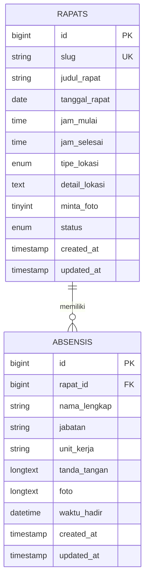

# Sistem Presensi Rapat Digital — Stasiun PSDKP Cilacap

Aplikasi web untuk mencatat kehadiran peserta rapat secara digital. Admin membuat jadwal rapat lalu membagikan tautan presensi. Peserta mengisi biodata, menandatangani langsung di layar, dan (jika diminta admin) mengambil foto bukti kehadiran dari kamera perangkatnya. Rekap kehadiran dapat diunduh sebagai PDF berkop instansi.

> Dokumen ini menjelaskan cara kerja, instalasi, konfigurasi, dan deploy aplikasi. Rancangan teknis dan antarmuka ada di [`Design.md`](Design.md).
> Terakhir diperbarui: 23 November 2026.

## Daftar Isi

1. [Fitur](#fitur)
2. [Teknologi](#teknologi)
3. [Alur Penggunaan](#alur-penggunaan)
4. [Struktur Proyek](#struktur-proyek)
5. [Skema Database](#skema-database)
6. [Daftar Rute](#daftar-rute)
7. [Aturan Bisnis](#aturan-bisnis)
8. [Instalasi Lokal](#instalasi-lokal)
9. [Konfigurasi Environment](#konfigurasi-environment)
10. [Deploy ke Vercel dan Supabase](#deploy-ke-vercel-dan-supabase)
11. [Keamanan dan Privasi](#keamanan-dan-privasi)
12. [Pemecahan Masalah](#pemecahan-masalah)
13. [Keterbatasan dan Pengembangan Lanjutan](#keterbatasan-dan-pengembangan-lanjutan)
14. [Ringkasan Perubahan](#ringkasan-perubahan)

---

## Fitur

### Untuk peserta (tanpa login)

| Fitur | Keterangan |
|---|---|
| Katalog rapat | Halaman utama (`/`) menampilkan daftar rapat, 10 per halaman, lengkap dengan badge status, jadwal, jenis lokasi, dan jumlah peserta yang sudah hadir. |
| Pencarian langsung | Kolom pencarian menyaring kartu rapat berdasarkan judul tanpa memuat ulang halaman. |
| Filter status | Tab **Semua**, **Aktif**, dan **Selesai**. |
| Jumlah hadir langsung | Angka peserta hadir diperbarui otomatis setiap 15 detik (berhenti saat tab tidak aktif). |
| Bagikan tautan | Tombol Share menyalin tautan presensi ke clipboard dan menampilkan notifikasi. |
| Form presensi | Nama lengkap, jabatan, dan unit kerja. |
| Tanda tangan digital | Kanvas tanda tangan sentuh/mouse (`signature_pad`), disimpan sebagai gambar PNG. Selalu ada di setiap rapat. |
| Foto bukti kehadiran | Muncul hanya jika admin mengaktifkannya untuk rapat tersebut. Diambil lewat kamera perangkat, dengan cadangan berupa tombol "Ambil dari perangkat". |
| Presensi otomatis tertutup | Setelah jam selesai terlewati, form menampilkan "Presensi Ditutup". Pengecekan diulang saat data dikirim. |

### Untuk admin (perlu login)

| Fitur | Keterangan |
|---|---|
| Dashboard | Statistik (total rapat, aktif, selesai, total kehadiran) dan daftar rapat dengan pencarian dan filter, 15 per halaman. |
| Tambah rapat | Judul, tanggal, jam mulai, jam selesai, tipe lokasi (Daring, Luring, Daring & Luring), detail lokasi, dan saklar **Minta foto bukti kehadiran**. |
| Detail rapat | Informasi rapat, tombol salin tautan presensi, daftar peserta (25 per halaman), dan pratinjau tanda tangan serta foto dalam jendela modal. |
| Unduh PDF | Daftar hadir resmi berkop instansi, siap cetak (A4 portrait). |
| Hapus rapat | Hapus satu rapat atau beberapa sekaligus (kotak centang). Ada konfirmasi dan data kehadiran ikut terhapus. |

---

## Teknologi

| Lapisan | Teknologi |
|---|---|
| Framework | Laravel 13 (PHP 8.3 atau lebih baru) |
| Tampilan | Blade, Bootstrap 5.3.3 dan Bootstrap Icons 1.11.3 (CDN), font Inter (Google Fonts), CSS kustom di `public/css/app.css` |
| Interaksi | JavaScript murni (tanpa framework JS) |
| Tanda tangan | [`signature_pad`](https://github.com/szimek/signature_pad) 4.2.0 (CDN) |
| PDF | [`barryvdh/laravel-dompdf`](https://github.com/barryvdh/laravel-dompdf) ^3.1 |
| Database | MySQL (pengembangan lokal) dan PostgreSQL via Supabase (produksi) |
| Hosting | Vercel (runtime container, FrankenPHP), file `Dockerfile.vercel` dan `vercel.json` |

Aplikasi **tidak memerlukan Node.js atau proses build aset**, karena semua pustaka antarmuka dimuat lewat CDN. `package.json` dan `vite.config.js` adalah bawaan Laravel dan tidak dipakai.

---

## Alur Penggunaan

```
ADMIN                                           PESERTA
─────                                           ───────
1. Login (/login)
2. Tambah rapat (judul, jadwal, lokasi,
   opsi foto bukti)
3. Salin tautan presensi  ───────────────────►  4. Buka tautan (HP/laptop)
   (dibagikan lewat WhatsApp, grup, dsb.)       5. Isi nama, jabatan, unit kerja
                                                6. Tanda tangan di kanvas
                                                7. (Jika diminta) ambil foto
                                                8. Kirim → "Presensi Berhasil"
9. Pantau peserta di halaman detail rapat
10. Unduh PDF rekap / hapus rapat bila perlu
```

Peserta juga bisa masuk lewat katalog di halaman utama, lalu menekan **Isi Presensi** pada rapat yang berstatus Aktif.

---

## Struktur Proyek

Hanya berkas yang relevan dengan aplikasi (bukan seluruh bawaan Laravel):

```
.
├── app/
│   ├── Http/
│   │   ├── Controllers/
│   │   │   ├── AdminController.php      # dashboard, tambah/hapus rapat, detail, PDF, gambar TTD/foto
│   │   │   ├── AuthController.php       # login dan logout admin
│   │   │   └── RapatController.php      # katalog, form presensi, simpan presensi, jumlah hadir
│   │   └── Requests/
│   │       ├── StorePresensiRequest.php # validasi presensi (TTD, foto bersyarat)
│   │       └── StoreRapatRequest.php    # validasi tambah rapat
│   └── Models/
│       ├── Rapat.php                    # slug otomatis, status otomatis, scope aktif/selesai/cari
│       ├── Absensi.php
│       └── User.php
├── bootstrap/app.php                    # redirect login, trust proxy
├── config/
│   ├── instansi.php                     # data kop surat PDF
│   ├── dompdf.php                       # pengaturan Dompdf (font Helvetica)
│   └── database.php                     # koneksi mysql dan pgsql
├── database/
│   ├── migrations/                      # struktur tabel
│   └── seeders/AdminSeeder.php          # membuat akun admin dari .env
├── public/
│   ├── css/app.css                      # design tokens dan komponen kustom
│   └── images/                          # logo_PSDKP.png (header, favicon), Logo-KKP.png (kop PDF)
├── resources/views/
│   ├── layouts/app.blade.php            # kerangka halaman, header, toast
│   ├── rapat/                           # index (katalog), form (presensi), ditutup
│   ├── admin/                           # dashboard, create, show, pdf_rekap, _nav
│   └── auth/login.blade.php
├── routes/web.php
├── Dockerfile.vercel                    # resep image untuk Vercel
├── Caddyfile                            # konfigurasi server FrankenPHP
└── vercel.json                          # konfigurasi layanan Vercel
```

---

## Skema Database



**`rapats`**

| Kolom | Tipe | Keterangan |
|---|---|---|
| `id` | bigint | Primary key |
| `slug` | string, unik | Dibuat otomatis dari judul ditambah 6 karakter acak. Dipakai pada URL publik. |
| `judul_rapat` | string | |
| `tanggal_rapat` | date | |
| `jam_mulai`, `jam_selesai` | time | Jam selesai harus lebih besar dari jam mulai. |
| `tipe_lokasi` | enum | `Daring`, `Luring`, `Daring & Luring` |
| `detail_lokasi` | text | Alamat ruangan dan/atau tautan rapat daring |
| `minta_foto` | tinyint (0/1) | `1` jika peserta wajib mengambil foto. Default `0`. |
| `status` | enum | `aktif` atau `selesai`, default `aktif`. Status sebenarnya dihitung otomatis dari waktu (lihat [Aturan Bisnis](#aturan-bisnis)). |

**`absensis`**

| Kolom | Tipe | Keterangan |
|---|---|---|
| `rapat_id` | foreign key | Ke `rapats.id`, dengan `ON DELETE CASCADE` |
| `nama_lengkap`, `jabatan`, `unit_kerja` | string | |
| `tanda_tangan` | longtext | Data URI gambar PNG (base64) |
| `foto` | longtext, nullable | Data URI gambar JPEG (base64), hanya terisi jika rapat meminta foto |
| `waktu_hadir` | datetime | Diisi saat data dikirim |

Tabel bawaan Laravel yang ikut dipakai: `users` (akun admin), `sessions` (session login), `cache` dan `cache_locks` (cache dan pembatasan laju), `jobs` (antrean, tidak dipakai aktif), dan `migrations`.

---

## Daftar Rute

**Publik**

| Method | URL | Nama | Fungsi |
|---|---|---|---|
| GET | `/` | `rapat.index` | Katalog rapat (parameter `q` untuk cari, `status` untuk filter) |
| GET | `/rapat-counts` | `rapat.counts` | JSON jumlah hadir per rapat (dibatasi 60 permintaan per menit) |
| GET | `/rapat/{slug}/presensi` | `rapat.form` | Form presensi, atau halaman "Presensi Ditutup" (status 403) |
| POST | `/rapat/{slug}/presensi` | `rapat.presensi.store` | Simpan presensi (dibatasi 10 per menit) |
| GET | `/up` | — | Pemeriksaan kesehatan bawaan Laravel |

**Autentikasi**

| Method | URL | Nama | Fungsi |
|---|---|---|---|
| GET | `/login` | `login` | Form login (hanya untuk tamu) |
| POST | `/login` | `login.attempt` | Proses login (dibatasi 5 per menit) |
| POST | `/logout` | `logout` | Keluar |

**Admin** (semua di bawah `/admin`, perlu login)

| Method | URL | Nama | Fungsi |
|---|---|---|---|
| GET | `/admin` | `admin.dashboard` | Dashboard |
| GET | `/admin/rapat/create` | `admin.rapat.create` | Form tambah rapat |
| POST | `/admin/rapat` | `admin.rapat.store` | Simpan rapat |
| GET | `/admin/rapat/{id}` | `admin.rapat.show` | Detail rapat dan peserta |
| GET | `/admin/rapat/{id}/pdf` | `admin.rapat.pdf` | Unduh PDF rekap |
| DELETE | `/admin/rapat/{id}` | `admin.rapat.destroy` | Hapus satu rapat |
| DELETE | `/admin/rapat` | `admin.rapat.destroy-many` | Hapus beberapa rapat (maksimal 100 per permintaan) |
| GET | `/admin/absensi/{id}/tanda-tangan` | `admin.absensi.ttd` | Menyajikan gambar tanda tangan |
| GET | `/admin/absensi/{id}/foto` | `admin.absensi.foto` | Menyajikan foto bukti |

---

## Aturan Bisnis

- **Status otomatis.** Sebuah rapat dianggap **Selesai** jika waktu sekarang sudah melewati `tanggal_rapat` ditambah `jam_selesai`. Jika belum, status mengikuti kolom `status` (`aktif`). Zona waktu aplikasi diatur ke `Asia/Jakarta`.
- **Presensi hanya untuk rapat aktif.** Rapat yang sudah selesai menolak form dan pengiriman data (halaman "Presensi Ditutup").
- **Tanda tangan wajib** di setiap rapat. **Foto wajib** hanya jika rapat dibuat dengan saklar foto aktif. Validasi dilakukan di server, bukan hanya di browser.
- **Pencegahan presensi ganda.** Peserta dengan nama lengkap dan unit kerja yang sama (tidak membedakan huruf besar-kecil) pada rapat yang sama akan ditolak.
- **Pengaturan foto ditentukan saat rapat dibuat.** Saat ini belum ada fitur edit rapat.
- **Penghapusan rapat bersifat permanen.** Seluruh data kehadiran rapat tersebut (termasuk tanda tangan dan foto) ikut terhapus dalam satu transaksi.
- **Akses admin.** Semua akun pada tabel `users` dapat masuk ke area admin. Tidak ada peran atau tingkatan hak akses, dan tidak ada halaman pendaftaran. Akun dibuat lewat seeder.

---

## Instalasi Lokal

### Prasyarat

- PHP 8.3 atau lebih baru dengan ekstensi: `gd`, `mbstring`, `pdo_mysql` (dan/atau `pdo_pgsql`), `intl`, `zip`, serta ekstensi standar Laravel
- Composer 2
- MySQL 8 atau MariaDB (atau database PostgreSQL)

Ekstensi `gd` wajib. Tanpa ekstensi itu gambar tanda tangan dan foto tidak tampil di PDF.

### Langkah

```bash
# 1. Ambil kode dan pasang dependensi
git clone https://github.com/<username>/<nama-repo>.git
cd <nama-repo>
composer install

# 2. Siapkan environment
cp .env.example .env
php artisan key:generate
```

Buka `.env` dan sesuaikan koneksi database (lihat [Konfigurasi Environment](#konfigurasi-environment)). Lalu buat database kosong, misalnya:

```sql
CREATE DATABASE sistem_absensi CHARACTER SET utf8mb4 COLLATE utf8mb4_unicode_ci;
```

```bash
# 3. Buat tabel dan akun admin
php artisan migrate
php artisan db:seed --class=AdminSeeder

# 4. Jalankan
php artisan serve
```

Buka `http://127.0.0.1:8000`, dan login admin di `/login` dengan `ADMIN_EMAIL` dan `ADMIN_PASSWORD` dari `.env`.

**Penting:**

- Jalankan seeder **dengan `--class=AdminSeeder`**. Perintah `php artisan db:seed` tanpa opsi menjalankan `DatabaseSeeder` bawaan yang membuat akun uji (`test@example.com`).
- Skrip `composer run setup` bawaan Laravel menjalankan `npm install` dan `npm run build`. Itu tidak diperlukan oleh aplikasi ini.
- Kamera pada form presensi hanya berfungsi di `localhost` atau HTTPS. Jika menguji dari HP lewat alamat IP (`http://192.168...`), tombol **Buka Kamera** tidak aktif, tetapi **Ambil dari perangkat** tetap dapat dipakai.

### Menguji dari HP di jaringan yang sama

```bash
php artisan serve --host=0.0.0.0 --port=8000
```

Buka admin dan peserta lewat alamat IP laptop yang sama (misalnya `http://192.168.1.10:8000`), agar tautan presensi yang disalin berisi alamat yang benar.

---

## Konfigurasi Environment

Contoh nilai di bawah adalah placeholder. **Jangan menyimpan kredensial asli di `.env.example`.**

| Variabel | Contoh | Keterangan |
|---|---|---|
| `APP_NAME` | `Sistem Presensi Rapat` | Di `.env`, nilai berspasi harus diapit tanda kutip. |
| `APP_ENV` | `local` / `production` | |
| `APP_KEY` | `base64:...` | Buat dengan `php artisan key:generate`. Gunakan kunci berbeda untuk produksi. |
| `APP_DEBUG` | `true` / `false` | **Wajib `false` di produksi.** |
| `APP_URL` | `https://nama-proyek.vercel.app` | |
| `APP_LOCALE` | `id` | Agar nama hari dan bulan tampil dalam bahasa Indonesia. Bawaannya `en`. |
| `DB_CONNECTION` | `mysql` / `pgsql` | |
| `DB_HOST`, `DB_PORT` | `127.0.0.1`, `3306` | Untuk Supabase, gunakan host dan port pooler. |
| `DB_DATABASE`, `DB_USERNAME`, `DB_PASSWORD` | | Untuk Supabase, username berbentuk `postgres.[PROJECT-REF]`. |
| `DB_SSLMODE` | `require` | Untuk koneksi PostgreSQL/Supabase. |
| `SESSION_DRIVER` | `database` | Wajib `database` (atau `cookie`) di Vercel, karena disk tidak permanen. |
| `SESSION_SECURE_COOKIE` | `true` | Aktifkan di produksi HTTPS. |
| `CACHE_STORE` | `database` | Dipakai juga oleh pembatasan laju permintaan. |
| `LOG_CHANNEL` | `stderr` | Di Vercel, log terbaca lewat Runtime Logs. |
| `ADMIN_EMAIL` | `admin@contoh.id` | Dipakai `AdminSeeder`. |
| `ADMIN_PASSWORD` | *(kata sandi kuat)* | Dipakai `AdminSeeder`. Gunakan kata sandi yang unik dan kuat. |

### Data kop surat PDF

Isi kop diatur di `config/instansi.php`. Setiap nilai punya bawaan di file itu dan dapat ditimpa lewat environment:

| Variabel | Isi |
|---|---|
| `INSTANSI_NAMA1` | Baris nama kementerian |
| `INSTANSI_NAMA2` | Baris nama direktorat jenderal |
| `INSTANSI_UNIT` | Baris nama unit/stasiun |
| `INSTANSI_ALAMAT` | Alamat |
| `INSTANSI_KONTAK1`, `INSTANSI_KONTAK2` | Baris telepon/faksimile dan laman/surel |

Tanda `|` (garis tegak lurus) di dalam nilai berfungsi sebagai pemisah baris pada kop. Logo kop diatur pada kunci `logo` di `config/instansi.php` (bawaan: `images/Logo-KKP.png`, relatif terhadap folder `public/`).

### Aturan penulisan nilai

- **Di file `.env`**, nilai yang berisi spasi atau karakter khusus harus diberi tanda kutip: `APP_NAME="Sistem Presensi Rapat"`. Nilai berisi `$` atau `#` (misalnya kata sandi) diapit kutip tunggal.
- **Di dashboard Vercel**, nilai ditulis apa adanya, **tanpa** tanda kutip.

---

## Deploy ke Vercel dan Supabase

Vercel tidak menyediakan runtime PHP bawaan untuk Laravel, sehingga aplikasi dijalankan sebagai **container** (FrankenPHP). Image dibangun oleh Vercel dari `Dockerfile.vercel`. **Docker tidak perlu dipasang di laptop** untuk deploy lewat GitHub.

### Berkas deploy

| Berkas | Fungsi |
|---|---|
| `Dockerfile.vercel` | Memasang PHP 8.4 dengan ekstensi `intl`, `zip`, `gd`, `pdo_pgsql`, memasang dependensi Composer, dan menjalankan FrankenPHP. Nama berakhiran `.vercel` membuat Vercel memakai container, bukan menebak framework dari `package.json`. |
| `Caddyfile` | Menyajikan folder `public/` dan meneruskan permintaan PHP. |
| `vercel.json` | Mendeklarasikan layanan container dan mengarahkan semua permintaan ke layanan itu. |
| `.dockerignore` | Mengecualikan `.env*`, `vendor`, `tests`, dan `.git` dari image. |

Jika build gagal dengan pesan `STATIC_BUILD_NO_OUT_DIR ... "dist"`, artinya Vercel mendeteksi Vite. Pastikan file `Dockerfile.vercel` dan `vercel.json` ada di repository, atau ubah **Framework Preset** proyek menjadi **Container** pada Settings → Build & Development Settings.

### Langkah deploy

1. **Siapkan database Supabase.** Buat project baru (pilih region terdekat) dan catat password database.
2. **Ambil data koneksi** lewat tombol **Connect** di Supabase. Gunakan pooler, bukan Direct connection: pada plan gratis, Direct connection hanya lewat IPv6.
   - **Session pooler** (port 5432), untuk menjalankan migrasi dari laptop.
   - **Transaction pooler** (port 6543), untuk aplikasi di Vercel. Mode ini tidak mendukung prepared statements, dan hal itu sudah ditangani oleh `PDO::ATTR_EMULATE_PREPARES` pada `config/database.php`.
3. **Jalankan migrasi dari laptop.** Buat file `.env.supabase` (jangan di-commit) berisi `DB_*` Session pooler, `SESSION_DRIVER`, `CACHE_STORE`, `ADMIN_EMAIL`, dan `ADMIN_PASSWORD`. Lalu:

   ```bash
   php artisan migrate --env=supabase --force
   php artisan db:seed --class=AdminSeeder --env=supabase
   ```

4. **Amankan tabel di Supabase.** Tabel pada schema `public` secara bawaan terjangkau lewat Data API Supabase. Aplikasi ini tidak memakainya, jadi aktifkan Row Level Security tanpa policy. Jalankan di SQL Editor, dan ulangi setiap ada migrasi yang menambah tabel baru:

   ```sql
   DO $$
   DECLARE r record;
   BEGIN
     FOR r IN SELECT tablename FROM pg_tables WHERE schemaname = 'public' LOOP
       EXECUTE format('ALTER TABLE public.%I ENABLE ROW LEVEL SECURITY', r.tablename);
     END LOOP;
   END $$;
   ```

   Laravel tetap berjalan normal karena memakai role `postgres`.

5. **Push ke GitHub dan import ke Vercel** (Add New → Project). Isi **Environment Variables** (tanpa tanda kutip) sebelum deploy: `APP_KEY`, `APP_ENV=production`, `APP_DEBUG=false`, `APP_URL`, `APP_LOCALE=id`, `DB_CONNECTION=pgsql`, `DB_HOST`, `DB_PORT=6543`, `DB_DATABASE=postgres`, `DB_USERNAME`, `DB_PASSWORD`, `DB_SSLMODE=require`, `SESSION_DRIVER=database`, `SESSION_SECURE_COOKIE=true`, `CACHE_STORE=database`, `LOG_CHANNEL=stderr`, serta variabel `INSTANSI_*` bila ingin menimpa bawaan.
6. **Redeploy** setiap kali Environment Variables diubah, karena perubahan tidak berlaku pada deployment yang sudah berjalan.
7. **Uji:** buka `/up`, login admin, buat rapat, isi presensi dari HP, lalu unduh PDF.

### Urutan saat mengubah struktur database

Agar tidak ada jeda error di situs yang sedang dipakai:

| Jenis perubahan | Urutan |
|---|---|
| **Menambah** kolom (opsional atau berdefault) | Jalankan migrasi ke Supabase **dulu**, baru push kode. |
| **Menghapus** kolom | Push kode **dulu**, tunggu status **Ready**, baru jalankan migrasi ke Supabase. |

Jangan mengubah migrasi yang sudah pernah dijalankan. Selalu buat migrasi baru.

### Catatan operasional

Periksa kebijakan terbaru kedua layanan, karena dapat berubah:

- **Vercel Hobby** diperuntukkan bagi penggunaan pribadi non-komersial. Untuk penggunaan resmi instansi, pertimbangkan plan yang sesuai.
- **Supabase Free** menjeda proyek yang lama tidak aktif, memiliki batas ukuran database, dan tidak memiliki backup otomatis. Karena presensi dipakai hanya saat ada rapat, database dapat terjeda dan aplikasi menampilkan error saat dibuka. Lakukan ekspor data secara berkala (PDF rekap atau `pg_dump`), atau gunakan plan berbayar.
- **Runtime container Vercel** berstatus beta pada saat dokumen ini ditulis.

---

## Keamanan dan Privasi

| Aspek | Penerapan |
|---|---|
| Autentikasi | Seluruh `/admin/*` dilindungi middleware `auth`. Login dibatasi 5 percobaan per menit dan session diperbarui setelah login. |
| CSRF | Semua formulir memakai token CSRF. Penghapusan memakai metode `DELETE` lewat form. |
| Pembatasan laju | Presensi 10 per menit, login 5 per menit, jumlah hadir 60 per menit (per IP). |
| Validasi gambar | Tanda tangan dan foto divalidasi di server: harus berupa data URI PNG/JPEG yang benar-benar terbaca sebagai gambar, dengan batas ukuran. |
| Penyajian gambar | Tanda tangan dan foto hanya dapat dilihat admin yang login lewat rute khusus, dengan header `private` dan `nosniff`. Halaman daftar peserta tidak memuat data gambar sekaligus. |
| XSS | Data yang disisipkan ke notifikasi dan modal lewat JavaScript memakai `textContent`. Blade meng-escape keluaran. |
| Session | Gambar base64 tidak disimpan ke session saat validasi gagal (`$dontFlash`). |
| Proxy | `trustProxies` diaktifkan agar URL dan deteksi HTTPS benar di belakang Vercel. |
| Database | Aktifkan RLS pada tabel Supabase (lihat bagian deploy). |

**Data pribadi.** Aplikasi menyimpan nama, jabatan, unit kerja, tanda tangan, dan (opsional) foto wajah peserta. Informasikan tujuan pengumpulan data kepada peserta, batasi akun admin seperlunya, dan tetapkan kebijakan penyimpanan dan penghapusan data.

**Berkas rahasia.**

- Jangan meng-commit `.env`, `.env.supabase`, atau berkas lain berisi kredensial. Tambahkan pola `.env.*` ke `.gitignore` dan kecualikan `.env.example`.
- `.env.example` hanya boleh berisi nilai contoh, bukan kata sandi atau `APP_KEY` yang dipakai sungguhan.
- Jika kredensial pernah ter-commit, ganti kredensial itu (kata sandi database, `ADMIN_PASSWORD`, `APP_KEY`). Menghapus berkas dari commit terbaru tidak menghapusnya dari riwayat Git.

---

## Pemecahan Masalah

| Gejala | Penyebab dan solusi |
|---|---|
| Build Vercel: `STATIC_BUILD_NO_OUT_DIR ... "dist"` | Vercel mendeteksi Vite. Pastikan `Dockerfile.vercel` dan `vercel.json` ada, atau pilih preset **Container**. |
| Halaman `500 Server Error` di Vercel | Lihat Runtime Logs. Penyebab umum: `APP_KEY` atau variabel `DB_*` belum diisi, atau lupa **Redeploy** setelah mengubah variabel. |
| `Failed to parse dotenv file ... unexpected whitespace` | Ada nilai berspasi tanpa tanda kutip di `.env`. Beri kutip. |
| `could not find driver` | Ekstensi `pdo_mysql` atau `pdo_pgsql` belum aktif di PHP. |
| `Tenant or user not found` (Supabase) | Username harus `postgres.[PROJECT-REF]` dan host harus host pooler dari dashboard. |
| `could not translate host name` / `Network is unreachable` | Memakai host Direct connection (IPv6). Ganti dengan host pooler. |
| `prepared statement ... already exists` | Opsi `PDO::ATTR_EMULATE_PREPARES` pada koneksi `pgsql` belum aktif atau belum ter-deploy. |
| `Unknown column ...` atau `Field ... doesn't have a default value` | Struktur tabel tidak sama dengan kode. Jalankan migrasi pada database yang benar dan perhatikan urutan push dan migrasi di atas. |
| Admin terlempar ke halaman login setelah pindah halaman | Session tidak persisten. Pastikan `SESSION_DRIVER=database` dan tabel `sessions` ada. |
| Tautan presensi berawalan `http://` di produksi | `trustProxies` belum aktif atau belum ter-deploy. |
| Rapat langsung tampil "Selesai" atau jamnya meleset 7 jam | Zona waktu bukan `Asia/Jakarta`. Cek `config/app.php`, lalu `php artisan config:clear`. |
| Nama hari dan bulan berbahasa Inggris | Set `APP_LOCALE=id`. |
| Teks PDF berupa simbol aneh | Pakai font bawaan PDF (`Helvetica`, sudah menjadi pengaturan saat ini) dan bersihkan `storage/fonts`. |
| Tanda tangan atau foto tidak tampil di PDF | Ekstensi PHP `gd` belum aktif. |
| Tombol kamera tidak berfungsi | Halaman harus dibuka lewat HTTPS atau `localhost`, dan izin kamera harus diberikan. Gunakan "Ambil dari perangkat" sebagai cadangan. |
| Kelas atau berkas tidak ditemukan hanya di server | Linux membedakan huruf besar-kecil. Pastikan nama folder dan berkas sesuai, misalnya `app/Models/Rapat.php`. |

---

## Keterbatasan dan Pengembangan Lanjutan

**Keterbatasan saat ini**

- Belum ada fitur **edit rapat**, termasuk mengubah saklar foto setelah rapat dibuat.
- Belum ada **penghapusan lunak** (soft delete) atau tempat sampah. Penghapusan rapat permanen.
- Tanda tangan dan foto disimpan sebagai teks base64 di database. Sederhana dan kompatibel dengan hosting tanpa disk permanen, tetapi memperbesar ukuran database. Foto dikecilkan (maksimal 720 piksel, JPEG) sebelum dikirim.
- Foto **tidak** dicantumkan di halaman daftar peserta admin secara langsung selain lewat pratinjau, dan di PDF hanya sebagai miniatur.
- PDF dibuat saat tombol diklik. Rapat dengan peserta sangat banyak dapat mendekati batas waktu fungsi serverless.
- Belum ada peran admin dan pengelolaan akun lewat antarmuka. Pengujian otomatis baru berupa contoh bawaan Laravel.
- Berkas `AGENTS.md`, `CLAUDE.md`, `package.json`, `vite.config.js`, `resources/js`, dan `database/database.sqlite` adalah bawaan Laravel dan tidak dipakai aplikasi.

**Ide pengembangan**

- Edit rapat dan duplikasi rapat.
- Soft delete dengan tempat sampah.
- Ekspor Excel dan filter rentang tanggal.
- Kode QR tautan presensi untuk ditampilkan di layar atau proyektor.
- Manajemen akun admin dan peran.
- Penyimpanan foto dan tanda tangan di object storage.
- Pengujian otomatis untuk alur presensi dan status rapat.

---

## Ringkasan Perubahan

Urutan perkembangan utama proyek:

1. Dasar aplikasi: tabel `rapats` dan `absensis`, status rapat otomatis, katalog publik, form presensi dengan tanda tangan digital.
2. Area admin: login, dashboard, tambah rapat, detail rapat, dan unduh PDF rekap.
3. Deploy ke Vercel (container) dan Supabase (PostgreSQL).
4. Penyederhanaan data: penghapusan kolom penyelenggara dan NIP.
5. Foto bukti kehadiran opsional per rapat, termasuk tampilan di halaman admin dan PDF.
6. Penyempurnaan kop surat PDF (logo dan susunan baris).
7. Penghapusan rapat satu per satu dan massal dari dashboard admin.

---

## Lisensi

Aplikasi ini dikembangkan untuk kebutuhan Stasiun PSDKP Cilacap. Lisensi penggunaan belum ditetapkan. Framework Laravel dilisensikan di bawah [MIT](https://opensource.org/licenses/MIT).